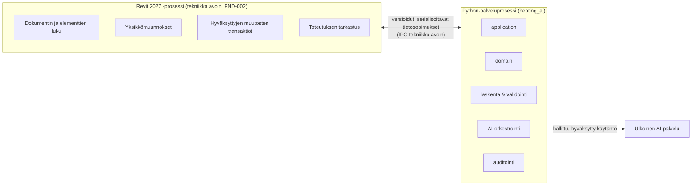
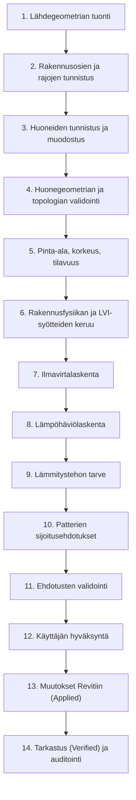

# Arkkitehtuurin yleiskuvaus

> Tila: luonnos (FND-001). Perustuu [ADR-0001](../decisions/ADR-0001-modular-architecture.md) (Proposed).
> Revit-integraatiotekniikka ja prosessien välinen viestintä ovat **avoimia** (FND-002).

## 1. Kokonaiskuva

Järjestelmä on **modulaarinen monoliitti**, joka koostuu kahdesta prosessista:

- Revit API -olioita ei siirretä prosessirajan yli.
- Rajapinta koostuu versioiduista, validoiduista tietosopimuksista (FND-005).
- Ulkoinen AI on erillinen, hallittu osa (hybridimalli). Malliaineistoa ei lähetetä ilman hyväksyttyä käytäntöä.

## 2. Kerrokset Python-prosessissa

| Kerros | Vastuu | Saa riippua |
|---|---|---|
| `domain` | Domain-käsitteet, invariantit, tilat. Puhdas Python. | Vain standardikirjasto |
| `application` | Käyttötapaukset ja työnkulut (tuleva) | `domain`, `contracts` |
| `contracts` | Versioidut prosessirajan ja laskennan tietosopimukset (tuleva, FND-005) | `domain` |
| `adapters/*` | Revit-, LLM- ja tallennusliitokset (tuleva) | `application`, `contracts`, `domain` |

Muut tavoiterakenteen moduulit (`geometry`, `heating_planner`, `validation`, `audit`, `dxf_ingestion`, …)
luodaan vasta niitä vastaavien tehtävien alkaessa.

## 3. Käsittelyputki (ADDENDUM-0001 §2)

Vaiheet 1–9 ja 11 ovat deterministisiä. AI osallistuu vain vaiheeseen 10 (ja avustaa
käyttötarkoituksen tunnistuksessa sekä puuttuvien tietojen tunnistamisessa).

## 4. Erotettavat tilat

Geometria tunnistettu → huone-ehdokas → huone validoitu → syötteet täydelliset → laskenta suoritettu →
laskenta varmennettu → ehdotus luotu → ehdotus validoitu → ehdotus hyväksytty → Applied → Verified.

Tilamallin toteutus on tehtävän FND-008 (ja GEO-/CALC-tehtävien) vastuulla.

## 5. Nykyinen toteutus (FND-001)

- `heating_ai.domain.identity`: `RoomId` (pysyvä sisäinen tunniste), `SourceType`, `SourceReference`
  (jäljitettävä viite lähdegeometriaan). Nämä toteuttavat ADDENDUM-0001 §1 periaatteen
  "stable internal identity and traceable relationship to its source geometry" perustason.
- Ei Revit-, AI-, DXF- tai ML-toteutusta.
