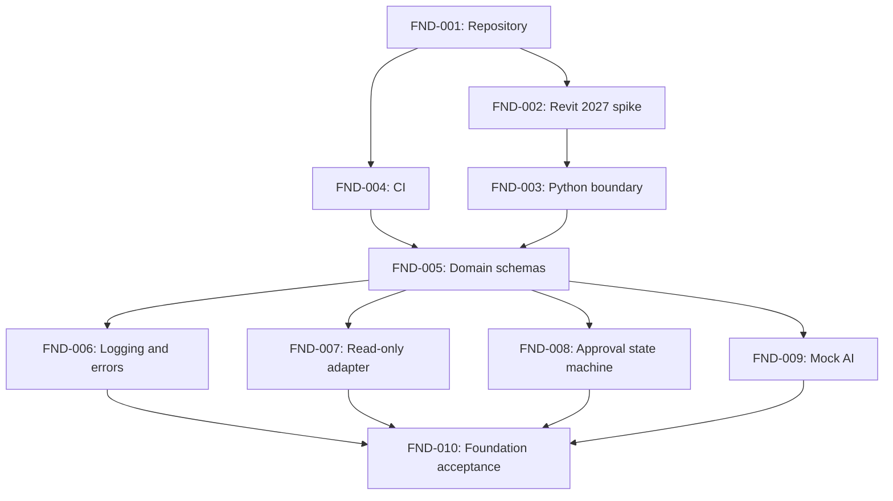

# Roadmap

Voimassa oleva tehtäväjärjestys. Lähteet: `CODEX_START.md` §11 ja
`ADDENDUM-0001` §9 (addendum korvaa vaiheet 2→).

Seuraavaan vaiheeseen ei siirrytä ennen edellisen vaiheen hyväksymiskriteerien täyttymistä.

Tilat: `Not started` · `In progress` · `Done` (hyväksymiskriteerit täyttyneet ja testit ajettu) · `Blocked`.

## Vaihe 1 – Foundation

| ID | Tehtävä | Riippuu | Tila |
|---|---|---|---|
| FND-001 | Repository ja projektin säännöt | – | Done |
| FND-002 | Revit 2027 -yhteensopivuusselvitys (pyRevit, Python-ajoympäristö, Revit API, C#/.NET 10, IPC) → ADR | FND-001 | **Seuraava** |
| FND-003 | Python-ympäristö ja riippuvuuksien erottelu (prosessiraja) | FND-002 | Not started |
| FND-004 | CI ja testausrunko | FND-001 | Not started |
| FND-005 | Tietomallit ja rajapintasopimukset | FND-003, FND-004 | Not started |
| FND-006 | Konfiguraatio, lokitus ja virhekoodit | FND-005 | Not started |
| FND-007 | Revitin read-only-adapteri | FND-005 | Not started |
| FND-008 | Hyväksyntä- ja tehtävätilamalli | FND-005 | Not started |
| FND-009 | Mock AI -adapteri | FND-005 | Not started |
| FND-010 | Foundationin hyväksymistestit | FND-006…009 | Not started |

## Vaihe 2 – Geometria ja huoneiden muodostus

| ID | Tehtävä | Tila |
|---|---|---|
| GEO-001 | Lähdegeometrian normalisointi | Not started |
| GEO-002 | Rakennusosien tunnistus | Not started |
| GEO-003 | Huonerajojen tunnistus | Not started |
| GEO-004 | Huoneolioiden muodostus | Not started |
| GEO-005 | Huonegeometrian validointi | Not started |
| GEO-006 | Pinta-alan, korkeuden ja tilavuuden laskenta | Not started |

## Vaihe 3 – Huonekohtaiset insinöörilaskennat

| ID | Tehtävä | Tila |
|---|---|---|
| CALC-001 | Insinöörilaskennan syötetietomalli | Not started |
| CALC-002 | Huoneen käyttötarkoitus ja luokittelu | Not started |
| CALC-003 | Ilmanvaihdon suunnittelusyötteiden keruu | Not started |
| CALC-004 | Huonekohtainen ilmavirtalaskenta | Not started |
| CALC-005 | Vaipan lämpötekniset ominaisuudet | Not started |
| CALC-006 | Huonekohtainen lämpöhäviölaskenta | Not started |
| CALC-007 | Lämmitystehon tarpeen laskenta | Not started |
| CALC-008 | Laskennan validointi ja auditointi | Not started |

Edellytys CALC-004/CALC-006:lle: sovellettavat suomalaiset säädökset, standardit ja niiden
versiot on dokumentoitu ja käyttäjän hyväksymät.

## Vaihe 4 – Patterisuunnittelu

| ID | Tehtävä | Tila |
|---|---|---|
| ROOM-001 | Patteriperheiden rekisteri | Not started |
| ROOM-002 | Deterministiset sijoittelusäännöt | Not started |
| ROOM-003 | AI-avusteinen sijoitusehdotus | Not started |
| ROOM-004 | Visuaalinen esikatselu | Not started |
| ROOM-005 | Hyväksytty Revit-mallin muutos | Not started |
| ROOM-006 | Käyttäjän hyväksymistestit | Not started |

## Myöhemmät vaiheet

Tehtävä-ID:t määritetään myöhemmin. DXF ja datasetit integroituvat samaan huonedomainiin (ADDENDUM-0001 §9).

- **DXF ja datasetit:** DXF-sisäänluku, geometrian tunnistus, merkintöjen ja huoneiden tunnistus,
  datasetin rakenne, annotointi, aineiston alkuperä- ja käyttöoikeustiedot.
- **ML ja tuotantovalmius:** koulutusympäristö, arviointi, vertailu deterministiseen ja LLM-ratkaisuun,
  malliversiointi, suorituskykytestit, tietoturva- ja käyttöoikeustarkastukset.

## Huomio numeroinnista

`CODEX_START.md` §11 käyttää tunnuksia ROOM-001…ROOM-008 eri sisällöllä kuin ADDENDUM-0001.
Tässä roadmapissa on käytetty addendumin numerointia. Vanhat ROOM-001 (normalisointi) ja
ROOM-002 (seinät ja ikkunat) vastaavat sisällöltään tehtäviä GEO-001…GEO-003.
